  

# ⚖️ Awesome Legal OCR & Legacy Contract Digitization 📄✨

  <strong>🚀 A curated directory of software, tools, neural models, and enterprise cloud APIs for Legal OCR, Intelligent Document Processing (IDP), legacy contract digitization, clause extraction, layout parsing, and document intelligence.</strong>

---

## 📑 Table of Contents

- [📊 Sector Overview & Market Dynamics](#-sector-overview--market-dynamics)
- [🏢 Proprietary & SaaS Platforms](#-proprietary--saas-platforms)
- [💻 Open-Source Software & Toolkits](#-open-source-software--toolkits)
- [🔍 Key Features to Look For](#-key-features-to-look-for)
- [🌟 Star History](#-star-history)
- [💖 Support & Community](#-support--community)
- [🤝 Contributing](#-contributing)
- [📜 License](#-license)

---

## 📊 Sector Overview & Market Dynamics

The global Intelligent Document Processing (IDP) and Legal OCR market is estimated at **$1.8 billion to $2.5 billion in 2024**, projected to surpass **$6.5 billion to $8.0 billion by 2030** at an estimated compound annual growth rate (CAGR) of ~28%–32%, driven by enterprise migrations to automated contract lifecycle management (CLM), regulatory compliance audits, and LLM-powered legacy contract discovery. 📈

Market concentration exhibits a **moderately fragmented landscape** bifurcated into two tiers: hyperscalers (Microsoft, Google Cloud, AWS) dominate high-throughput utility OCR and foundational vision-language extraction, while specialized vertical vendors (Icertis, Hyperscience, ABBYY, Rossum) capture high-margin contract intelligence and human-in-the-loop legal workflow niches, preventing a single winner-take-all outcome. 🌐

---

## 🏢 Proprietary & SaaS Platforms

The following hosted platforms and commercial software provide high-accuracy OCR, intelligent document analysis, table recognition, and metadata extraction for legacy contracts and legal paperwork. Entries are sorted in descending order of vendor scale (company valuation / market capitalization). 🏆

| Software / Platform | 💰 Vendor Valuation / Revenue Scale | 🏷️ Starting Pricing | 🎁 Free Tier / Trial Allowance | 📝 Overview & Legal OCR Capabilities |
| :--- | :--- | :--- | :--- | :--- |
| [Microsoft Azure AI Document Intelligence](https://azure.microsoft.com/en-us/products/ai-services/ai-document-intelligence) | **$3.1 Trillion** *(Market Cap)* | **$1.50 per 1,000 pages** (Read OCR) / **$10.00 per 1,000 pages** (Prebuilt contract model) | **Free F0 tier: 500 pages/month** forever (up to 20 pages/minute rate limit) | Cloud-scale document extraction service with dedicated prebuilt models for contracts, agreements, invoice headers, and complex nested table hierarchies. |
| [Google Cloud Document AI](https://cloud.google.com/document-ai) | **$2.1 Trillion** *(Market Cap)* | **$1.50 per 1,000 pages** (Document OCR) / **$30.00 per 1,000 pages** (Contract & specialized parsers) | **First 1,000 pages/month free** (Document OCR) + **$300 90-day free trial credit** for new Google Cloud accounts | Unified document understanding platform with deep learning neural networks optimized for high-volume contract parsing, clause identification, and legal entity extraction. |
| [AWS Textract](https://aws.amazon.com/textract/) | **$1.9 Trillion** *(Market Cap)* | **$1.50 per 1,000 pages** (Detect Document Text) / **$15.00 per 1,000 pages** (Analyze Document - Tables & Forms) | **1,000 pages/month free** for the first 3 months across Detect Document Text and Analyze Document APIs | Fully managed OCR engine capable of parsing scanned contracts, multi-column agreements, key-value pairs, and tabular legal disclosures without template maintenance. |
| [Adobe Acrobat Pro OCR](https://www.adobe.com/acrobat/pro.html) | **$220 Billion** *(Market Cap)* | **$19.99/month** (Annual subscription billed monthly) per user license | **7-day free trial** with complete access to Acrobat Pro desktop, cloud OCR, PDF editing, and export capabilities | Benchmark desktop and cloud PDF utility featuring optical character recognition, searchable PDF/A archival generation, redaction tools, and table export to Microsoft Excel/Word. |
| [Icertis Contract Intelligence](https://www.icertis.com/) | **$5.0 Billion** *(Private Valuation)* | **$2,000.00/month** enterprise starting baseline (multi-user CLM deployment) | **30-day guided interactive trial sandbox** upon request with sample contract portfolio digitization | Specialized enterprise contract intelligence suite incorporating OCR to scan, extract metadata, identify standard/non-standard clauses, and manage risk across legacy contract archives. |
| [Kofax OmniPage (Tungsten Automation)](https://www.tungstenautomation.com/products/omnipage) | **$2.0 Billion** *(Private Equity Valuation)* | **$149.00 one-time perpetual license** (OmniPage Standard) / **$499.00** (OmniPage Ultimate) | **15-day free trial** of OmniPage Ultimate desktop software with batch document conversion capabilities | High-volume desktop and batch OCR engine offering superior layout reproduction, form processing, and multi-page contract digitization for law firms and corporate legal departments. |
| [Hyperscience](https://www.hyperscience.com/) | **$1.6 Billion** *(Series E Valuation)* | **$1,200.00/month** starting tier (approx. $15,000 annual baseline commitment) | **14-day guided proof-of-concept trial** with up to 500 document extractions upon consultation | Human-in-the-loop Intelligent Document Processing (IDP) platform built specifically to parse degraded scanned documents, handwritten signatures, and complex legacy legal records. |
| [Rossum](https://rossum.ai/) | **$1.25 Billion** *(Series A/B Unicorn Valuation)* | **$1,250.00/month** starting Business plan (annual subscription covering up to 12,000 documents/year) | **14-day free trial** with access to cloud workspace and up to 300 document page extractions | Cloud-native cognitive document processing platform with AI-based spatial recognition for automated extraction of unstructured contract terms, covenants, and schedule data. |
| [ABBYY FineReader Server](https://www.abbyy.com/finereader-server/) | **$1.0 Billion** *(Private Equity Valuation)* | **$99.00/month** (FineReader PDF Business) / **$3,500.00/year** baseline server licensing | **30-day free trial** of FineReader Server (processing up to 100 pages) / **7-day trial** for FineReader PDF Desktop | Enterprise-grade server OCR and document conversion architecture engineered for 24/7 automated indexing, PDF/A long-term legal archival, and high-throughput backfile conversion. |
| [Readiris Corporate (IRIS / Canon)](https://www.irislink.com/readiris) | **$800 Million** *(IRIS / Canon Information Management)* | **$129.00 one-time perpetual license** (Readiris Pro) / **$199.00** (Readiris Corporate) | **10-day free trial** of Readiris Corporate desktop with a 100-page conversion threshold | Desktop OCR and PDF management suite supporting over 130 languages, automated document separation, hyper-compression, and automated export to legal document management systems. |

---

## 💻 Open-Source Software & Toolkits

Open-source document processing frameworks, neural OCR engines, and document layout parsers allow legal teams and developers to build self-hosted, air-gapped, and cost-effective contract digitization pipelines without vendor lock-in. Entries are sorted in descending order of GitHub Stars_Count. 🌟

| Project & Repository | ⭐ GitHub_Stars | 🛠️ Primary Language / Ecosystem | 📖 Description & Legal Digitization Use Case |
| :--- | :--- | :--- | :--- |
| [Stirling-PDF](https://github.com/Stirling-Tools/Stirling-PDF) |  | Java, Docker | Self-hosted, privacy-first web-based PDF manipulation and OCR suite capable of batch splitting, merging, watermarking, and converting legacy contracts without transmitting data to external third parties. |
| [PaddleOCR](https://github.com/PaddlePaddle/PaddleOCR) |  | Python, C++ | Ultra-lightweight and industrial-grade OCR system supporting 80+ languages, document layout analysis (PP-Structure), table recognition, and key information extraction (KIE) for complex contract documents. |
| [MinerU](https://github.com/opendatalab/MinerU) |  | Python | A comprehensive open-source tool for parsing complex PDFs and multi-column documents into clean Markdown/JSON, preserving contract structures, tables, formulas, and legal appendices. |
| [Tesseract OCR](https://github.com/tesseract-ocr/tesseract) |  | C++, C | The foundational, battle-tested open-source OCR engine with LSTM neural net models supporting over 100 languages, widely integrated into legal document scanning and archival utilities. |
| [Paperless-ngx](https://github.com/paperless-ngx/paperless-ngx) |  | Python, TypeScript | Community-driven document management system (DMS) that transforms scanned legacy paperwork into searchable PDF/A archives with automatic tagging, OCR text layer generation, and full-text search. |
| [Marker](https://github.com/datalab-to/marker) |  | Python | Deep learning document conversion tool that converts scanned PDFs, legal briefs, and contracts into highly accurate Markdown format with automated header, table, and list reconstruction. |
| [OCRmyPDF](https://github.com/ocrmypdf/OCRmyPDF) |  | Python | Injects an accurate OCR text layer into scanned legal PDFs while generating archival-compliant PDF/A files, automatically deskewing images, correcting page rotations, and validating clean vector rendering. |
| [EasyOCR](https://github.com/JaidedAI/EasyOCR) |  | Python, PyTorch | Ready-to-use optical character recognition library supporting 80+ languages and scripts, ideal for integrating line-level and paragraph-level text detection in custom legal automation pipelines. |
| [Surya](https://github.com/datalab-to/surya) |  | Python, PyTorch | Multilingual OCR and document analysis engine featuring accurate text line detection, reading order recovery, layout segmentation, and table extraction across 90+ languages. |
| [Documenso](https://github.com/documenso/documenso) |  | TypeScript, Node.js | The open-source digital document signing platform enabling developers to self-host contract signing, verification workflows, and audit trails for digitized legal agreements. |
| [Unstructured](https://github.com/Unstructured-IO/unstructured) |  | Python | Production-grade ingestion framework that preprocesses and extracts unstructured text, tables, and clauses from scanned contracts and PDF briefs into clean LLM-ready embeddings and RAG pipelines. |
| [Donut](https://github.com/clovaai/donut) |  | Python, PyTorch | OCR-free Document Understanding Transformer that parses visual documents directly into structured JSON representations without requiring a separate text-detection OCR pipeline. |
| [docTR](https://github.com/mindee/doctr) |  | Python, TensorFlow, PyTorch | Seamless end-to-end OCR and document analysis framework capable of nested text detection, recognition, and orientation correction for scanned enterprise documentation. |
| [Pytesseract](https://github.com/madmaze/pytesseract) |  | Python | Python wrapper for Google's Tesseract-OCR Engine, serving as the standard OCR bridge for quick prototyping and legal document ingestion scripts. |
| [Layout-Parser](https://github.com/Layout-Parser/layout-parser) |  | Python | Unified deep learning toolkit for document image analysis, enabling legal researchers to segment complex multi-column legal texts, extract figures, and identify footnotes. |
| [Paperwork](https://github.com/openpaperwork/paperwork) |  | Python, GTK | Personal document manager designed for scanning and indexing physical papers on Linux and Windows, providing local OCR search without relying on cloud services. |
| [PDF Document Layout Analysis](https://github.com/huridocs/pdf-document-layout-analysis) |  | Python | Open-source machine learning model trained by HURIDOCS to segment and extract sections, headers, and paragraphs from human rights reports and legal case files. |
| [Kraken](https://github.com/mittagessen/kraken) |  | Python | Turnkey OCR and handwriting recognition (HTR) system optimized for historical legal manuscripts, degraded legacy contracts, and non-Latin script documentation. |
| [Uwazi](https://github.com/huridocs/uwazi) |  | JavaScript, Node.js | Open-source database tool developed for human rights defenders and legal clinics to organize, search, and cross-reference collections of digitized legal cases and evidentiary records. |

---

## 🔍 Key Features to Look For

When evaluating OCR and Intelligent Document Processing systems for legacy contract digitization, consider the following technical capabilities: 🧭

1. **📑 Layout & Multi-Column Parsing**: Legacy legal documents frequently feature multi-column layouts, margin notes, and footnotes. A high-quality engine reconstructs the natural reading order without intertwining adjacent columns.
2. **📊 Table & Schedule Extraction**: Contracts heavily rely on financial exhibits, fee schedules, and pricing grids. The OCR solution must extract cell coordinates and nested table headers faithfully into structured formats (CSV/JSON).
3. **✨ Deskewing & Binarization**: Historic contracts and carbon copies often suffer from skewed scans, bleed-through, faded inks, and background noise. Adaptive thresholding and deskew pre-processing ensure optimal text recognition accuracy.
4. **🗄️ PDF/A Compliance**: For archival and regulatory admissibility, digitizing legacy contracts requires exporting into ISO-standardized PDF/A formats with embedded, searchable text layers.
5. **🔒 Air-Gapped & On-Premises Deployment**: Sensitive legal records frequently cannot leave an organization's security perimeter. Self-hosted and open-source models ensure complete data sovereignty and GDPR/HIPAA compliance.
6. **🧠 Key Clause & Entity Identification**: Advanced IDP systems use downstream NLP/LLM layers to automatically identify effective dates, governing laws, indemnity caps, termination notices, and non-compete clauses.

---

##  Star History

---

## 💖 Support & Community

If you find this legal OCR and contract digitization curated resource helpful:
- ⭐ **Star** this repository on GitHub to boost visibility for the open-source community!
- 🍴 **Fork** it to save it to your own profile or create your own specialized adaptations.
- 📢 **Share** it with fellow legaltech engineers, legal ops teams, researchers, and data engineers.
- ☕ **Sponsor & Buy a Coffee**: Support ongoing maintenance and curated updates directly via the [GitHub Sponsor Dashboard](https://github.com/sponsors/ishandutta2007).

---

## 🤝 Contributing

Contributions, additions, and suggestions are welcome! 💡
Please review the contribution guidelines or submit a pull request with new legal OCR tools, benchmarks, and libraries.

---

## 📜 License

This project is licensed under the [MIT License](LICENSE).
